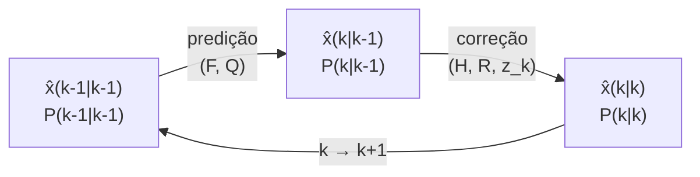

# Aula 2 — O Filtro de Kalman: estimação recursiva e o caso não estacionário

**Curso:** Introdução aos Filtros Adaptativos
**Duração sugerida:** 100 min (2 × 50 min)
**Pré-requisitos:** Aula 1 (filtro de Wiener, EQM, ortogonalidade), álgebra matricial, distribuição gaussiana
**Ferramentas:** MATLAB R2023b ou mais recente; *Control System Toolbox* (`idare`); opcionalmente *Sensor Fusion and Tracking Toolbox* (`trackingKF`). A função `wienerFIR.m` da Aula 1 é reutilizada na Prática 3.

---

## Sumário

1. [Objetivos de aprendizagem](#1-objetivos-de-aprendizagem)
2. [Recapitulando Wiener e o que falta](#2-recapitulando-wiener-e-o-que-falta)
3. [O modelo de espaço de estados](#3-o-modelo-de-espaço-de-estados)
4. [Intuição em uma dimensão: fundir duas incertezas](#4-intuição-em-uma-dimensão-fundir-duas-incertezas)
5. [O algoritmo](#5-o-algoritmo)
6. [De onde vem o ganho de Kalman](#6-de-onde-vem-o-ganho-de-kalman)
7. [Prática 1 — Estimando uma tensão (escalar)](#7-prática-1--estimando-uma-tensão-escalar)
8. [Prática 2 — Rastreamento de posição e velocidade](#8-prática-2--rastreamento-de-posição-e-velocidade)
9. [Prática 3 — Kalman em regime permanente é Wiener](#9-prática-3--kalman-em-regime-permanente-é-wiener)
10. [Prática 4 — Kalman como filtro adaptativo (e o elo com o RLS)](#10-prática-4--kalman-como-filtro-adaptativo-e-o-elo-com-o-rls)
11. [Ferramentas do MATLAB e extensões](#11-ferramentas-do-matlab-e-extensões)
12. [Quando o Kalman falha](#12-quando-o-kalman-falha)
13. [Exercícios propostos](#13-exercícios-propostos)
14. [Referências](#14-referências)

---

## 1. Objetivos de aprendizagem

Ao final da aula, o aluno deverá ser capaz de:

- escrever um problema de estimação como **modelo de espaço de estados** (equações de processo e de medição);
- executar o ciclo **predição → correção** do filtro de Kalman e interpretar o **ganho** e a **inovação**;
- explicar o papel das covariâncias $\mathbf{Q}$ e $\mathbf{R}$ como "botões de ajuste" do filtro;
- verificar a **consistência** de um filtro (inovação branca, NIS);
- demonstrar numericamente que o Kalman em **regime permanente** coincide com o Wiener causal;
- ver o Kalman como um **filtro adaptativo** e relacioná-lo ao RLS.

---

## 2. Recapitulando Wiener e o que falta

Na Aula 1, obtivemos o melhor filtro linear sob estas condições:

| Wiener (Aula 1) | O que acontece na prática |
|---|---|
| Processos estacionários | Alvos manobram, ganhos de sensores derivam, sistemas mudam |
| Estatísticas $\mathbf{R}$ e $\mathbf{p}$ conhecidas | Raramente conhecidas a priori |
| Solução em bloco | Dados chegam amostra a amostra |
| Sem noção de transitório/inicialização | O início da estimação importa |

O filtro de Kalman (R. E. Kalman, 1960) resolve o mesmo problema de EQM mínimo, mas com **um modelo dinâmico explícito** do fenômeno e com um **cálculo recursivo**: a cada nova medição, atualiza-se a estimativa sem reprocessar o passado.

> **Atenção à notação.** Na Aula 1, $\mathbf{R}$ era a matriz de autocorrelação da entrada, $x(n)$ era a entrada e $d(n)$ o sinal desejado. Nesta aula, $\mathbf{x}_k$ é o **estado**, $z_k$ é a **medição**, $\mathbf{Q}$ é a covariância do ruído de processo e $\mathbf{R}$ é a covariância do ruído de medição. São símbolos reutilizados, mas objetos diferentes.

---

## 3. O modelo de espaço de estados

O fenômeno de interesse é descrito por um vetor de **estado** $\mathbf{x}_k \in \mathbb{R}^n$, que não observamos diretamente:

$$
\begin{aligned}
\mathbf{x}_k &= \mathbf{F}\,\mathbf{x}_{k-1} + \mathbf{w}_{k-1}, & \mathbf{w}_k &\sim \mathcal{N}(\mathbf{0}, \mathbf{Q}) \quad &\text{(processo)}\\
\mathbf{z}_k &= \mathbf{H}\,\mathbf{x}_k + \mathbf{v}_k, & \mathbf{v}_k &\sim \mathcal{N}(\mathbf{0}, \mathbf{R}) \quad &\text{(medição)}
\end{aligned}
$$

- $\mathbf{F}$: dinâmica (como o estado evolui sozinho);
- $\mathbf{H}$: o que o sensor enxerga do estado;
- $\mathbf{Q}$: o quanto desconfiamos do **modelo** (incerteza da dinâmica);
- $\mathbf{R}$: o quanto desconfiamos do **sensor**;
- $\mathbf{w}_k$ e $\mathbf{v}_k$: brancos, mutuamente independentes e independentes do estado inicial.

**Exemplo (usado na Prática 2).** Um veículo se move em linha reta com velocidade aproximadamente constante. Com estado $\mathbf{x} = [\,p\ \ v\,]^{\mathsf T}$ (posição em m, velocidade em m/s), período de amostragem $T_s$ (em s) e aceleração aleatória $a_k$ como ruído de processo:

$$
\mathbf{F} = \begin{bmatrix} 1 & T_s \\ 0 & 1 \end{bmatrix},\qquad
\mathbf{G} = \begin{bmatrix} T_s^2/2 \\ T_s \end{bmatrix},\qquad
\mathbf{Q} = \sigma_a^2\,\mathbf{G}\mathbf{G}^{\mathsf T},\qquad
\mathbf{H} = \begin{bmatrix} 1 & 0 \end{bmatrix}.
$$

O sensor (por exemplo, um GPS) mede apenas a posição.

---

## 4. Intuição em uma dimensão: fundir duas incertezas

Suponha que, antes da medição, a melhor estimativa de uma grandeza seja $\hat{x}^-$ com variância $P^-$ (a **predição**). Chega uma medição $z$ com variância $R$. Como combinar?

Uma média ponderada pelo inverso das variâncias:

$$
\hat{x} = \hat{x}^- + K\,(z - \hat{x}^-), \qquad K = \frac{P^-}{P^- + R}, \qquad P = (1-K)\,P^- .
$$

Duas leituras do mesmo resultado:

- **Ganho $K \in [0,1]$:** se o sensor é ruim ($R \gg P^-$), $K \to 0$ e confiamos na predição; se o modelo é incerto ($P^- \gg R$), $K \to 1$ e confiamos na medição.
- **Informação soma:** $\dfrac{1}{P} = \dfrac{1}{P^-} + \dfrac{1}{R}$. A variância após a fusão é **menor** que ambas.

O filtro de Kalman é a generalização vetorial e dinâmica dessa ideia, repetida a cada instante.

---

## 5. O algoritmo

Notação: $\hat{\mathbf{x}}_{k\mid k-1}$ é a estimativa de $\mathbf{x}_k$ usando medições até $k-1$ (**a priori**), e $\hat{\mathbf{x}}_{k\mid k}$ usa também $\mathbf{z}_k$ (**a posteriori**). $\mathbf{P}$ é a covariância do erro de estimação.

**Inicialização:** $\hat{\mathbf{x}}_{0\mid 0}$ e $\mathbf{P}_{0\mid 0}$ (incerteza inicial grande se pouco se sabe).

**Para cada $k = 1, 2, \dots$**

| Etapa | Equações |
|---|---|
| **Predição** | $\hat{\mathbf{x}}_{k\mid k-1} = \mathbf{F}\,\hat{\mathbf{x}}_{k-1\mid k-1}$ |
| | $\mathbf{P}_{k\mid k-1} = \mathbf{F}\,\mathbf{P}_{k-1\mid k-1}\,\mathbf{F}^{\mathsf T} + \mathbf{Q}$ |
| **Inovação** | $\boldsymbol{\nu}_k = \mathbf{z}_k - \mathbf{H}\,\hat{\mathbf{x}}_{k\mid k-1}$ |
| | $\mathbf{S}_k = \mathbf{H}\,\mathbf{P}_{k\mid k-1}\,\mathbf{H}^{\mathsf T} + \mathbf{R}$ |
| **Ganho** | $\mathbf{K}_k = \mathbf{P}_{k\mid k-1}\,\mathbf{H}^{\mathsf T}\,\mathbf{S}_k^{-1}$ |
| **Correção** | $\hat{\mathbf{x}}_{k\mid k} = \hat{\mathbf{x}}_{k\mid k-1} + \mathbf{K}_k\,\boldsymbol{\nu}_k$ |
| | $\mathbf{P}_{k\mid k} = (\mathbf{I}-\mathbf{K}_k\mathbf{H})\,\mathbf{P}_{k\mid k-1}\,(\mathbf{I}-\mathbf{K}_k\mathbf{H})^{\mathsf T} + \mathbf{K}_k\mathbf{R}\,\mathbf{K}_k^{\mathsf T}$ |

A última linha é a **forma de Joseph**: algebricamente equivale a $(\mathbf{I}-\mathbf{K}_k\mathbf{H})\mathbf{P}_{k\mid k-1}$, mas preserva simetria e positividade de $\mathbf{P}$ frente a erros de arredondamento. Use-a em código real.



**Observação importante:** a covariância $\mathbf{P}$ e o ganho $\mathbf{K}$ **não dependem dos dados** $\mathbf{z}_k$, apenas de $\mathbf{F},\mathbf{H},\mathbf{Q},\mathbf{R}$. Portanto, podem ser calculados offline, e é isso que permite o regime permanente da Prática 3.

---

## 6. De onde vem o ganho de Kalman

### 6.1 Escolha de $\mathbf{K}$ que minimiza a covariância

Considere o estimador do tipo $\hat{\mathbf{x}} = \hat{\mathbf{x}}^- + \mathbf{K}\boldsymbol{\nu}$. Para qualquer $\mathbf{K}$, a covariância do erro a posteriori é

$$
\mathbf{P}(\mathbf{K}) = (\mathbf{I}-\mathbf{K}\mathbf{H})\,\mathbf{P}^-\,(\mathbf{I}-\mathbf{K}\mathbf{H})^{\mathsf T} + \mathbf{K}\mathbf{R}\mathbf{K}^{\mathsf T}.
$$

O EQM total é o traço dessa matriz. Expandindo e usando $\mathbf{S} = \mathbf{H}\mathbf{P}^-\mathbf{H}^{\mathsf T}+\mathbf{R}$:

$$
\operatorname{tr}\mathbf{P}(\mathbf{K}) = \operatorname{tr}\mathbf{P}^- - 2\operatorname{tr}(\mathbf{K}\mathbf{H}\mathbf{P}^-) + \operatorname{tr}(\mathbf{K}\mathbf{S}\mathbf{K}^{\mathsf T}).
$$

Derivando em relação a $\mathbf{K}$ e igualando a zero:

$$
-2\,\mathbf{P}^-\mathbf{H}^{\mathsf T} + 2\,\mathbf{K}\mathbf{S} = \mathbf{0}
\quad\Longrightarrow\quad
\boxed{\mathbf{K} = \mathbf{P}^-\mathbf{H}^{\mathsf T}\mathbf{S}^{-1}}
$$

### 6.2 Ligação com a Aula 1: ortogonalidade

Com esse ganho, o erro de estimação a posteriori é **ortogonal à inovação** (e, de forma geral, a todas as medições passadas). É o mesmo princípio da ortogonalidade de Wiener, agora aplicado de forma recursiva: cada medição nova só contribui com a parte **imprevisível** dela, a inovação.

### 6.3 Propriedades que valem a pena destacar

- **Otimalidade.** Com ruídos gaussianos, o Kalman fornece a estimativa de EQM mínimo entre **todos** os estimadores. Sem gaussianidade, é o **melhor estimador linear** que usa apenas as covariâncias dadas.
- **Inovação branca.** Se o modelo estiver correto, $\boldsymbol{\nu}_k$ é branca, de média nula e covariância $\mathbf{S}_k$. Isso fornece **testes de consistência** (Prática 2).
- **Honestidade.** $\mathbf{P}_{k\mid k}$ é a **incerteza prevista** do filtro. Um bom filtro tem erro real compatível com ela.

---

## 7. Prática 1 — Estimando uma tensão (escalar)

**Cenário.** Uma tensão de referência $x_k$ (em V) deriva lentamente como passeio aleatório, $x_k = x_{k-1} + w_{k-1}$, e um conversor A/D a mede com ruído $\sigma_z = 0{,}2$ V. Aqui $F = H = 1$.

Objetivo: ver o efeito de $Q$. Com $Q = 0$ o filtro assume tensão constante, e o resultado é a **média recursiva**: o ganho cai como $1/k$ e o filtro "adormece".

```matlab
%% Prática 1 — Kalman escalar: o papel de Q
clear; clc; close all
rng(1)

N  = 500;
sw = 0.02;                          % desvio do passeio aleatório [V/passo]
sz = 0.2;                           % desvio do ruído de medição [V]
xt = 3.3 + cumsum(sw*randn(N, 1));  % tensão verdadeira [V]
z  = xt + sz*randn(N, 1);           % medições [V]

Qs   = [0, sw^2, 100*sw^2];         % sem modelo de deriva | ótimo | exagerado
nome = {'Q = 0', 'Q = \sigma_w^2', 'Q = 100\sigma_w^2'};

xh = zeros(N, 3);  K = zeros(N, 3);
for i = 1:3
    [xh(:, i), K(:, i)] = kf1d(z, Qs(i), sz^2, z(1), sz^2);
    fprintf('%-18s  RMSE = %.3f V\n', nome{i}, sqrt(mean((xh(:, i) - xt).^2)))
end
fprintf('%-18s  RMSE = %.3f V\n', 'medição bruta', sqrt(mean((z - xt).^2)))

figure('Position', [100 100 900 600])
tiledlayout(2, 1, 'TileSpacing', 'compact')
nexttile
plot(1:N, z, '.', 'Color', [.75 .75 .75]); hold on
plot(1:N, xt, 'k', 'LineWidth', 1.5)
plot(1:N, xh(:, 1), 'LineWidth', 1.2)
plot(1:N, xh(:, 2), 'LineWidth', 1.2)
plot(1:N, xh(:, 3), 'LineWidth', 1.2)
grid on, ylabel('Tensão [V]')
legend(['medições', 'verdadeiro', nome], 'Location', 'best')

nexttile
semilogy(1:N, K, 'LineWidth', 1.2), grid on
xlabel('k'), ylabel('Ganho K_k'), legend(nome)

%% ----- função local -----
function [xh, K] = kf1d(z, Q, R, x0, P0)
    N = numel(z);  xh = zeros(N, 1);  K = zeros(N, 1);
    x = x0;  P = P0;
    for k = 1:N
        P    = P + Q;                   % predição (F = 1)
        K(k) = P / (P + R);             % ganho
        x    = x + K(k)*(z(k) - x);     % correção
        P    = (1 - K(k))*P;
        xh(k) = x;
    end
end
```

**Para discutir:**

- Com $Q = 0$, $K_k \to 0$: o filtro para de aprender e **fica para trás** quando a tensão deriva.
- Com $Q$ exagerado, $K$ fica alto e o filtro repassa o ruído da medição.
- O melhor desempenho está perto de $Q = \sigma_w^2$, e a razão $Q/R$ é o que realmente define o comportamento: ela fixa o compromisso **memória × agilidade**, o mesmo que o passo $\mu$ do LMS e o fator de esquecimento do RLS controlam.

---

## 8. Prática 2 — Rastreamento de posição e velocidade

**Cenário.** Modelo de velocidade quase constante (seção 3), $T_s = 0{,}1$ s, durante 60 s, aceleração com $\sigma_a = 0{,}5$ m/s², GPS com $\sigma_z = 5$ m. A velocidade **nunca é medida**: o filtro a infere a partir da dinâmica.

```matlab
%% Prática 2 — Rastreamento posição/velocidade (modelo de velocidade constante)
clear; clc; close all
rng(1)

Ts = 0.1;  N = 600;  t = (0:N-1)*Ts;          % [s]
F  = [1 Ts; 0 1];
G  = [Ts^2/2; Ts];
H  = [1 0];
sigma_a = 0.5;   Q = sigma_a^2 * (G*G.');     % [m/s^2]; Q = covariância do ruído de processo
sigma_z = 5;     R = sigma_z^2;               % [m^2]

% --- simulação da "verdade" e das medições ---
x = zeros(2, N);  x(:, 1) = [0; 10];          % posição [m], velocidade [m/s]
for k = 2:N
    x(:, k) = F*x(:, k-1) + G*(sigma_a*randn);
end
z = H*x + sigma_z*randn(1, N);

% --- filtro de Kalman ---
xh = zeros(2, N);  P = zeros(2, 2, N);  Kh = zeros(2, N);  nis = nan(1, N);
xh(:, 1)   = [z(1); 0];                       % velocidade inicial desconhecida
P(:, :, 1) = diag([sigma_z^2, 100]);          % [m^2, (m/s)^2]

for k = 2:N
    % predição
    xp = F*xh(:, k-1);
    Pp = F*P(:, :, k-1)*F.' + Q;
    % inovação e ganho
    nu = z(k) - H*xp;
    S  = H*Pp*H.' + R;
    K  = (Pp*H.')/S;
    % correção (forma de Joseph)
    xh(:, k) = xp + K*nu;
    IKH = eye(2) - K*H;
    P(:, :, k) = IKH*Pp*IKH.' + K*R*K.';
    Kh(:, k) = K;
    nis(k) = nu^2/S;                          % inovação normalizada ao quadrado
end

% --- desempenho ---
rmse_z  = sqrt(mean((z - x(1, :)).^2));
rmse_p  = sqrt(mean((xh(1, 2:end) - x(1, 2:end)).^2));
rmse_v  = sqrt(mean((xh(2, 2:end) - x(2, 2:end)).^2));
fprintf('RMSE posição: medição = %.2f m | Kalman = %.2f m\n', rmse_z, rmse_p)
fprintf('RMSE velocidade (nunca medida): %.2f m/s\n', rmse_v)

% --- consistência: NIS médio ~ 1 (dimensão da medição = 1) ---
M  = N - 1;
lim = chi2inv([0.025 0.975], M) / M;
fprintf('NIS médio = %.2f   (aceitável em [%.2f, %.2f])\n', ...
        mean(nis, 'omitnan'), lim(1), lim(2))

% --- gráficos ---
sp = squeeze(sqrt(P(1, 1, :))).';
figure('Position', [100 100 900 750])
tiledlayout(3, 1, 'TileSpacing', 'compact')
nexttile
plot(t, z, '.', 'Color', [.7 .7 .7]); hold on
plot(t, x(1, :), 'k'); plot(t, xh(1, :), '--r'); grid on
ylabel('Posição [m]'), legend('GPS', 'verdadeira', 'Kalman', 'Location', 'northwest')
nexttile
plot(t, x(2, :), 'k'); hold on; plot(t, xh(2, :), '--r'); grid on
ylabel('Velocidade [m/s]'), legend('verdadeira', 'Kalman')
nexttile
plot(t, xh(1, :) - x(1, :)); hold on
plot(t, 3*sp, 'r:', t, -3*sp, 'r:'); grid on
xlabel('t [s]'), ylabel('Erro de posição [m]'), legend('erro', '\pm3\sigma previsto')

% --- ganho em regime permanente (Control System Toolbox) ---
Pss = idare(F.', H.', Q, R);                  % covariância a priori estacionária
Kss = (Pss*H.')/(H*Pss*H.' + R);
disp('Ganho final do filtro vs. ganho estacionário:')
disp(table(Kh(:, end), Kss, 'VariableNames', {'K_final', 'K_estacionario'}))
```

**Para discutir:**

- O erro de posição fica bem abaixo dos 5 m do sensor, e a **velocidade é recuperada** sem sensor de velocidade. Isso só é possível por causa do modelo $\mathbf{F}$.
- O erro real deve ficar dentro da faixa $\pm 3\sigma$ prevista por $\mathbf{P}$: o filtro "sabe o quanto erra".
- O NIS médio próximo de 1 indica filtro **consistente**. Refaça a simulação com o filtro usando $\mathbf{Q}$ muito menor que o real (exercício E5) e observe o NIS sair da faixa.
- Os ganhos $\mathbf{K}_k$ convergem para um valor **constante** $\mathbf{K}_{ss}$. Esse é o regime permanente, base da próxima prática.

---

## 9. Prática 3 — Kalman em regime permanente é Wiener

Esta é a prática que fecha o arco do curso: o Wiener (Aula 1) é o **limite estacionário** do Kalman.

**Modelo estacionário.** Um sinal de sensor (em V) segue um processo gauss-markoviano de primeira ordem, observado com ruído:

$$
x_k = a\,x_{k-1} + w_{k-1}, \quad w_k \sim \mathcal{N}(0, Q); \qquad z_k = x_k + v_k, \quad v_k \sim \mathcal{N}(0, R),
$$

com $|a| < 1$, de modo que $x_k$ é estacionário.

**Teoria.** Em regime permanente, o ganho $K$ é constante e o filtro vira um sistema **linear e invariante no tempo**:

$$
\hat{x}_{k\mid k} = (1-K)\,a\,\hat{x}_{k-1\mid k-1} + K\,z_k
\quad\Longrightarrow\quad
h_{\text{Kalman}}(j) = K\,\big[(1-K)\,a\big]^{j}, \quad j \ge 0.
$$

Essa resposta ao impulso (IIR) deve coincidir com a do **Wiener causal** para estimar $x_k$ a partir de $z_k, z_{k-1}, \dots$. Podemos verificar treinando o Wiener FIR da Aula 1, com entrada $z$ e sinal desejado $x$ (conhecido na simulação).

```matlab
%% Prática 3 — Kalman estacionário vs. Wiener FIR (usa wienerFIR.m da Aula 1)
clear; clc; close all
rng(2)

a = 0.95;  Q = 0.05;  R = 0.5;          % Q, R em V^2
N = 2e5;   L = 30;

x = filter(1, [1 -a], sqrt(Q)*randn(N, 1));   % processo estacionário [V]
z = x + sqrt(R)*randn(N, 1);                  % medição [V]

% --- Wiener: entrada z, desejado x ---
[w, ~, Jmin] = wienerFIR(z, x, L);

% --- Kalman em regime permanente (Control System Toolbox) ---
Pm = idare(a, 1, Q, R);                 % covariância a priori estacionária
K  = Pm / (Pm + R);                     % ganho estacionário
Pf = (1 - K) * Pm;                      % covariância a posteriori
hk = K * ((1 - K)*a).^(0:L-1).';        % resposta ao impulso do Kalman

fprintf('K = %.4f\n', K)
fprintf('EQM mínimo do Wiener (Jmin)      = %.4f V^2\n', Jmin)
fprintf('Covariância a posteriori do KF   = %.4f V^2\n', Pf)
fprintf('Variância da medição (sem filtro) = %.4f V^2\n', R)

figure
stem(0:L-1, w, 'filled'); hold on; stem(0:L-1, hk, 'o'); grid on
xlabel('j'), ylabel('resposta ao impulso')
legend('Wiener FIR (dados)', 'Kalman estacionário (teoria)')
title('O Kalman em regime permanente reproduz o Wiener')
```

**Valores esperados** (cálculo à mão para $a = 0{,}95$, $Q = 0{,}05$ V², $R = 0{,}5$ V²): $P^-\approx 0{,}159$ V², $K \approx 0{,}24$, $P \approx 0{,}12$ V², com polo do filtro em $(1-K)a \approx 0{,}72$. Confira com a saída do script.

**Para discutir:**

- Os coeficientes do Wiener coincidem com $h_{\text{Kalman}}(j)$: o filtro IIR do Kalman e o FIR longo do Wiener são **o mesmo estimador**, visto de dois lados.
- $J_{\min}$ (Wiener) $\approx$ $P_{k\mid k}$ (Kalman): o EQM mínimo é o mesmo.
- **O que o Kalman acrescenta:** a mesma estrutura funciona no transitório e para modelos **não estacionários**, como o da Prática 2, em que a posição não é estacionária e o Wiener clássico não se aplica diretamente.

---

## 10. Prática 4 — Kalman como filtro adaptativo (e o elo com o RLS)

Voltamos ao problema de **identificação de sistema** da Aula 1, agora com uma planta que **muda** no meio do experimento. Tratamos os coeficientes do filtro como **estado**:

$$
\mathbf{w}_k = \mathbf{w}_{k-1} + \mathbf{q}_{k-1}, \quad \mathbf{q}_k \sim \mathcal{N}(\mathbf{0}, q\,\mathbf{I}) \qquad\text{(coeficientes derivam)}
$$
$$
d_k = \mathbf{u}_k^{\mathsf T}\,\mathbf{w}_k + v_k, \quad v_k \sim \mathcal{N}(0, \sigma_v^2) \qquad\text{(medição)}
$$

Aqui $\mathbf{F} = \mathbf{I}$, $\mathbf{H}_k = \mathbf{u}_k^{\mathsf T}$ (o vetor de regressão **varia no tempo**), $\mathbf{Q} = q\mathbf{I}$ e $\mathbf{R} = \sigma_v^2$.

```matlab
%% Prática 4 — Kalman adaptativo vs. Wiener fixo (planta que muda)
clear; clc; close all
rng(4)

N  = 2000;  L = 2;  sv = 0.1;                 % sv [V]
u  = randn(N, 1);                             % excitação [V]
Um = toeplitz(u, [u(1); zeros(L-1, 1)]);      % linha k = u_k^T

% planta que muda abruptamente na metade do experimento
h = [repmat([1; -0.5], 1, N/2), repmat([0.5; 0.8], 1, N/2)];     % L × N
d = sum(Um.' .* h, 1).' + sv*randn(N, 1);

% --- Wiener global (Aula 1): um único conjunto de coeficientes ---
wW = wienerFIR(u, d, L);

% --- Kalman: F = I, H_k = u_k^T, Q = q*I, R = sv^2 ---
q  = 1e-4;  Qk = q*eye(L);  Rk = sv^2;
wk = zeros(L, 1);  Pk = eye(L);  wh = zeros(L, N);
for n = 1:N
    Pp = Pk + Qk;                              % predição (F = I)
    Hn = Um(n, :);                             % 1 × L
    S  = Hn*Pp*Hn.' + Rk;
    K  = (Pp*Hn.')/S;
    wk = wk + K*(d(n) - Hn*wk);                % correção
    Pk = (eye(L) - K*Hn)*Pp;
    wh(:, n) = wk;
end

figure('Position', [100 100 900 450])
plot(1:N, h.', 'k', 'LineWidth', 1.2); hold on
plot(1:N, wh.', 'LineWidth', 1.2)
yline(wW(1), ':b'); yline(wW(2), ':r'); grid on
xlabel('k'), ylabel('coeficientes')
title('Verdade (preto) × Kalman (cores) × Wiener fixo (tracejado)')
```

**Para discutir:**

- O Wiener da Aula 1 devolve **uma média** das duas plantas, que não descreve nenhuma delas. O Kalman **rastreia** a mudança em dezenas de amostras.
- $q$ regula a agilidade: $q$ grande segue mudanças rápidas com mais ruído; $q$ pequeno dá estimativas suaves mas lentas (exercício E7).
- **Elo com o RLS.** O RLS com fator de esquecimento $\lambda$ é equivalente a um Kalman para esse mesmo modelo em que, em vez de somar $\mathbf{Q}$, a covariância é **inflada** multiplicativamente, $\mathbf{P}_{k\mid k-1} = \mathbf{P}_{k-1\mid k-1}/\lambda$. Ou seja, o RLS é um caso particular de Kalman com uma escolha específica de incerteza do modelo. Ambos têm custo $\mathcal{O}(L^2)$ por amostra.

---

## 11. Ferramentas do MATLAB e extensões

| Necessidade | Ferramenta |
|---|---|
| Ganho estacionário de um modelo LTI | `idare` (Control System Toolbox) |
| Projeto de filtro de Kalman para modelo LTI | `kalman`, `kalmd` (Control System Toolbox) |
| Filtro de Kalman pronto, com modelos de movimento | `trackingKF` (Sensor Fusion and Tracking Toolbox) |
| Modelos **não lineares** | `extendedKalmanFilter` (EKF), `unscentedKalmanFilter` (UKF) |
| Estimação sobre toda a janela de dados | suavizadores (Rauch–Tung–Striebel) |

Exemplo de verificação cruzada com `trackingKF`, usando um modelo `Custom` para reproduzir o laço manual da Prática 2 (confira na documentação a convenção de `ProcessNoise` da sua versão antes de comparar resultados):

```matlab
kf = trackingKF('MotionModel', 'Custom', ...
                'StateTransitionModel', F, ...
                'MeasurementModel', H, ...
                'State', [z(1); 0], ...
                'StateCovariance', diag([sigma_z^2, 100]), ...
                'ProcessNoise', Q, ...
                'MeasurementNoise', R);
xk = zeros(2, N);  xk(:, 1) = kf.State;
for k = 2:N
    predict(kf);
    xk(:, k) = correct(kf, z(k));
end
```

**Extensões** (não cobertas nesta aula):

- **EKF/UKF:** para $\mathbf{x}_k = f(\mathbf{x}_{k-1}) + \mathbf{w}$ e $\mathbf{z}_k = h(\mathbf{x}_k) + \mathbf{v}$ não lineares, o EKF lineariza por Jacobianas; o UKF propaga pontos sigma.
- **Suavização:** usa também medições **futuras** (processamento offline), com EQM menor que o filtro.
- **Fusão de sensores:** vários sensores com $\mathbf{H}_i$ e $\mathbf{R}_i$ distintos entram em sequência na etapa de correção.

---

## 12. Quando o Kalman falha

| Problema | Sintoma | Remédio |
|---|---|---|
| Modelo errado ($\mathbf{F}$ inadequado) | Erro grande, inovação **não branca** | Reformular o modelo; aumentar $\mathbf{Q}$ |
| $\mathbf{Q}$ ou $\mathbf{R}$ mal ajustados | NIS fora da faixa; erro incompatível com $\mathbf{P}$ | Ajuste por consistência; estimação adaptativa de $\mathbf{Q},\mathbf{R}$ |
| Não linearidade forte | Divergência | EKF, UKF, filtros de partículas |
| Ruídos não gaussianos / *outliers* | Estimativas arrastadas por poucas medições ruins | *Gating* da inovação, filtros robustos |
| Problemas numéricos | $\mathbf{P}$ perde simetria ou positividade | Forma de Joseph, raiz quadrada de $\mathbf{P}$ |

> **Mensagem para o aluno:** o Kalman é **ótimo dentro do modelo**. A qualidade da estimação depende da qualidade do modelo e do ajuste de $\mathbf{Q}$ e $\mathbf{R}$. Verificar a consistência (inovação, NIS) faz parte do projeto.

---

## 13. Exercícios propostos

**E1 (analítico).** Deduza a fusão escalar da seção 4: mostre que $K = P^-/(P^-+R)$, $P = (1-K)P^-$ e $1/P = 1/P^- + 1/R$.

**E2 (analítico).** Na Prática 1 com $Q = 0$, $x_0$ conhecido com variância $P_0$, mostre que $K_k = \dfrac{1}{k + R/P_0}$. Para $P_0 \to \infty$, mostre que $\hat{x}_k$ é a média amostral das medições.

**E3 (analítico).** Mostre que a forma de Joseph se reduz a $(\mathbf{I}-\mathbf{K}\mathbf{H})\mathbf{P}^-$ quando $\mathbf{K} = \mathbf{P}^-\mathbf{H}^{\mathsf T}\mathbf{S}^{-1}$.

**E4 (analítico).** Para o modelo escalar da Prática 3, escreva a equação algébrica de Riccati para $P^-$, resolva-a em forma fechada e confira $P^-\approx 0{,}159$ V².

**E5 (MATLAB).** Na Prática 2, rode o filtro com $\mathbf{Q}$ multiplicado por $0{,}01$ e depois por $100$. Compare RMSE, NIS e a faixa $\pm 3\sigma$. Em qual caso o filtro é "otimista demais"?

**E6 (MATLAB).** Na Prática 3, varie $Q/R$ em $\{0{,}01;\,0{,}1;\,1;\,10\}$ e trace $K$ e $J_{\min}$. Qual o comprimento $L$ necessário para o Wiener FIR acompanhar o Kalman em cada caso?

**E7 (MATLAB).** Na Prática 4, varie $q \in \{10^{-6}, 10^{-4}, 10^{-2}\}$ e meça o tempo de convergência após a mudança e a variância das estimativas antes dela. Interprete como compromisso entre rastreamento e ruído.

**E8 (MATLAB).** Compare a Prática 4 com o RLS (fator de esquecimento $\lambda = 0{,}98$) implementado à mão. Escolha $q$ para que os dois tenham comportamento semelhante.

**E9 (reflexão).** Por que o Wiener clássico não se aplica diretamente ao modelo de velocidade constante da Prática 2? Que propriedade do sinal falha?

---

## 14. Referências

- R. E. Kalman, "A New Approach to Linear Filtering and Prediction Problems", *Journal of Basic Engineering*, 82(1), 1960.
- S. Haykin, *Adaptive Filter Theory*, 5ª ed., Pearson, 2014. (Cap. 10: filtros de Kalman.)
- D. Simon, *Optimal State Estimation*, Wiley, 2006.
- Y. Bar-Shalom, X. R. Li e T. Kirubarajan, *Estimation with Applications to Tracking and Navigation*, Wiley, 2001.
- T. Kailath, A. H. Sayed e B. Hassibi, *Linear Estimation*, Prentice Hall, 2000.
- B. D. O. Anderson e J. B. Moore, *Optimal Filtering*, Dover, 2005.
- G. Welch e G. Bishop, "An Introduction to the Kalman Filter", UNC-Chapel Hill, TR 95-041.
- P. S. R. Diniz, *Adaptive Filtering: Algorithms and Practical Implementation*, 5ª ed., Springer, 2020.
- Documentação MATLAB: [`idare`](https://www.mathworks.com/help/control/ref/idare.html), [`kalman`](https://www.mathworks.com/help/control/ref/ss.kalman.html), [`trackingKF`](https://www.mathworks.com/help/fusion/ref/trackingkf.html).
